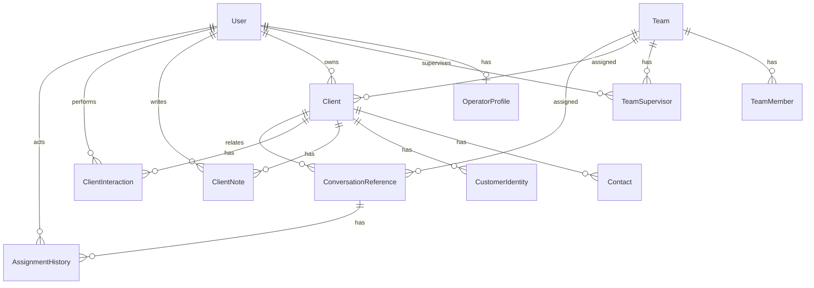

# F2.1 — Propuesta de modelo de datos (borrador, no aplicado)

## Identificadores externos
- chatwootAgentId (Int?) en OperatorProfile y ConversationReference/AssignmentHistory
- chatwootTeamId (Int?) en Team, ConversationReference, AssignmentHistory
- chatwootConversationId (Int) en ConversationReference (único)
- chatwootInboxId (Int?) en ConversationReference
- localAssigneeId / chatwootAssigneeId diferenciados

## ER (Mermaid)



## Prisma additions (append to schema.prisma)

```prisma
model Client {
  id               String    @id @default(uuid()) @db.Uuid
  name             String
  legalName        String?
  taxId            String?   @unique
  phone            String?
  email            String?
  address          String?
  notes            String?
  tags             String[]  @default([])
  origin           String?
  status           String    @default("active")
  isActive         Boolean   @default(true)
  ownerId          String?   @db.Uuid
  teamId           String?   @db.Uuid
  lastInteractionAt DateTime? @db.Timestamptz(6)
  createdAt        DateTime  @default(now()) @db.Timestamptz(6)
  updatedAt        DateTime  @updatedAt @db.Timestamptz(6)
  deletedAt        DateTime? @db.Timestamptz(6)

  owner            User?     @relation("ClientOwner", fields: [ownerId], references: [id], onDelete: SetNull)
  team             Team?     @relation(fields: [teamId], references: [id], onDelete: SetNull)
  contacts         Contact[]
  identities       CustomerIdentity[]
  clientNotes     ClientNote[]
  interactions     ClientInteraction[]
  conversations    ConversationReference[]

  @@index([name])
  @@index([phone])
  @@index([email])
  @@index([status])
  @@index([teamId])
  @@index([ownerId])
}

model Contact {
  id          String    @id @default(uuid()) @db.Uuid
  clientId    String    @db.Uuid
  firstName   String
  lastName    String?
  phones      String[]  @default([])
  whatsapp    String?
  email       String?
  jobTitle    String?
  isPrimary   Boolean   @default(false)
  preferences Json?
  isActive    Boolean   @default(true)
  createdAt   DateTime  @default(now()) @db.Timestamptz(6)
  updatedAt   DateTime  @updatedAt @db.Timestamptz(6)
  deletedAt   DateTime? @db.Timestamptz(6)

  client      Client    @relation(fields: [clientId], references: [id], onDelete: Cascade)
  conversationRefs ConversationReference[]

  @@index([clientId])
  @@index([isPrimary])
}

model CustomerIdentity {
  id        String   @id @default(uuid()) @db.Uuid
  clientId  String   @db.Uuid
  type      String
  value     String
  verified  Boolean  @default(false)
  source    String?
  createdAt DateTime @default(now()) @db.Timestamptz(6)

  client    Client   @relation(fields: [clientId], references: [id], onDelete: Cascade)

  @@unique([type, value])
  @@index([clientId])
}

model OperatorProfile {
  id             String   @id @default(uuid()) @db.Uuid
  userId         String   @unique @db.Uuid
  availability   String   @default("offline")
  workingHours   Json?
  chatwootAgentId Int?    @unique
  createdAt      DateTime @default(now()) @db.Timestamptz(6)
  updatedAt      DateTime @updatedAt @db.Timestamptz(6)

  user           User     @relation(fields: [userId], references: [id], onDelete: Cascade)
}

model TeamSupervisor {
  id        String   @id @default(uuid()) @db.Uuid
  teamId    String   @db.Uuid
  userId    String   @db.Uuid
  createdAt DateTime @default(now()) @db.Timestamptz(6)

  team      Team     @relation(fields: [teamId], references: [id], onDelete: Cascade)
  user      User     @relation(fields: [userId], references: [id], onDelete: Cascade)

  @@unique([teamId, userId])
  @@index([teamId])
  @@index([userId])
}

model ConversationReference {
  id                    String    @id @default(uuid()) @db.Uuid
  chatwootConversationId Int      @unique
  chatwootInboxId       Int?
  status                String    @default("open")
  priority              String?
  clientId              String?   @db.Uuid
  contactId             String?   @db.Uuid
  localAssigneeId       String?   @db.Uuid
  chatwootAssigneeId    Int?
  localTeamId           String?   @db.Uuid
  chatwootTeamId        Int?
  lastActivityAt        DateTime? @db.Timestamptz(6)
  createdAt             DateTime  @default(now()) @db.Timestamptz(6)
  updatedAt             DateTime  @updatedAt @db.Timestamptz(6)

  client                Client?   @relation(fields: [clientId], references: [id], onDelete: SetNull)
  contact               Contact?  @relation(fields: [contactId], references: [id], onDelete: SetNull)
  localAssignee         User?     @relation("ConvAssignee", fields: [localAssigneeId], references: [id], onDelete: SetNull)
  localTeam             Team?     @relation(fields: [localTeamId], references: [id], onDelete: SetNull)
  assignments           AssignmentHistory[]

  @@index([status])
  @@index([clientId])
  @@index([localAssigneeId])
  @@index([localTeamId])
}

model AssignmentHistory {
  id                     String   @id @default(uuid()) @db.Uuid
  conversationRefId      String   @db.Uuid
  fromUserId             String?  @db.Uuid
  toUserId               String?  @db.Uuid
  fromTeamId             String?  @db.Uuid
  toTeamId               String?  @db.Uuid
  fromChatwootAssigneeId Int?
  toChatwootAssigneeId   Int?
  reason                 String?
  actorId                String?  @db.Uuid
  syncStatus             String   @default("pending")
  syncError              String?
  createdAt              DateTime @default(now()) @db.Timestamptz(6)

  conversationRef        ConversationReference @relation(fields: [conversationRefId], references: [id], onDelete: Cascade)
  fromUser               User?    @relation("AssignFromUser", fields: [fromUserId], references: [id], onDelete: SetNull)
  toUser                 User?    @relation("AssignToUser", fields: [toUserId], references: [id], onDelete: SetNull)
  fromTeam               Team?    @relation("AssignFromTeam", fields: [fromTeamId], references: [id], onDelete: SetNull)
  toTeam                 Team?    @relation("AssignToTeam", fields: [toTeamId], references: [id], onDelete: SetNull)
  actor                  User?    @relation("AssignActor", fields: [actorId], references: [id], onDelete: SetNull)

  @@index([conversationRefId])
  @@index([createdAt])
}

model ClientNote {
  id        String   @id @default(uuid()) @db.Uuid
  clientId  String   @db.Uuid
  authorId  String?  @db.Uuid
  body      String
  createdAt DateTime @default(now()) @db.Timestamptz(6)

  client    Client   @relation(fields: [clientId], references: [id], onDelete: Cascade)
  author    User?    @relation(fields: [authorId], references: [id], onDelete: SetNull)

  @@index([clientId])
  @@index([createdAt])
}

model ClientInteraction {
  id         String   @id @default(uuid()) @db.Uuid
  clientId   String   @db.Uuid
  type       String
  summary    String
  actorId    String?  @db.Uuid
  occurredAt DateTime @default(now()) @db.Timestamptz(6)
  createdAt  DateTime @default(now()) @db.Timestamptz(6)

  client     Client   @relation(fields: [clientId], references: [id], onDelete: Cascade)
  actor      User?    @relation("InteractionActor", fields: [actorId], references: [id], onDelete: SetNull)

  @@index([clientId])
  @@index([occurredAt])
}
```

## Cambios a entidades existentes

- `User`: añadir relaciones `ownedClients`, `operatorProfile`, `supervisedTeams`, `clientNotes`, `interactions`, `convAssignments`, `assignFrom`, `assignTo`, `assignActor`.
- `Team`: añadir `chatwootTeamId Int? @unique`, `supervisors TeamSupervisor[]`, `clients Client[]`, `conversationRefs ConversationReference[]`, `assignFrom/To`.
- `Contact`: añadir relación `conversationRefs`.

## Reutilización
- User, Role, Permission, UserRole, RolePermission, Team, TeamMember, AuditLog, Session, SystemSetting, Integration, IntegrationEvent, OutboxMessage se reutilizan sin duplicación.

## Migración
- Una migración `f2_crm_attention` con CREATE TABLE/INDEX/FOREIGN KEY.
- No destructiva; preserva datos existentes.
- Backup de PostgreSQL antes de aplicar.

## Riesgos
- `CustomerIdentity @@unique([type,value])` global puede impedir que dos clientes compartan un mismo teléfono; es intencional para deduplicación, pero debe validarse en negocio.
- `taxId @unique` nullable permite múltiples nulls en PostgreSQL (correcto).
- `chatwootAgentId` Int? único solo cuando informado (PostgreSQL permite múltiples nulls).
